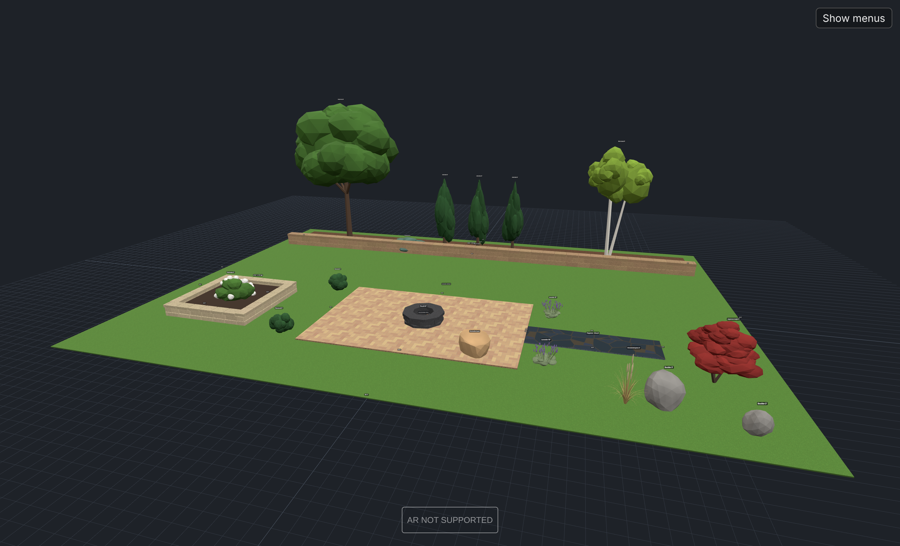

# QuestWalls

Full-size layout sketching for Meta Quest 3 passthrough, in the browser (WebXR + three.js, no install or build step).

| App | Path | What it's for |
| --- | --- | --- |
| **Wall Sketch** | [`/index.html`](index.html) | Rooms: walls, doors, furniture |
| **Yard Sketch** | [`/landscape/`](landscape/) | Landscaping: retaining walls, patios and beds, boulders, trees, shrubs |

Host the repo on any HTTPS static host (GitHub Pages works), open the page in the Quest Browser, and press **START AR**. Both apps also run on a desktop browser for planning with mouse and keyboard.

## Yard Sketch

- **Retaining walls**: draw a run of points and it's built course by course, in running bond with interlocking corners and a cap row. There are 6 block types (standard 18×6×12", large 18×8×12", garden 12×4×7", tumbled, natural stacked stone, and a boulder wall). Closing a wall makes a raised bed.
- **Curves**: walls and area edges can be straight or smooth. Flick the right stick ↔ while drawing (K on desktop) to switch, and you can mix sharp corners and curves in one shape for serpentine walls, kidney patios and round raised beds. Block counts and square footage follow the curve.
- **Patios & beds**: outline an area and fill it with one of 13 surfaces. Pavers come in running bond, herringbone, basketweave, 12×12, 24×24 slabs and ashlar; there's also flagstone, concrete, gravel, river rock, decomposed granite, mulch and lawn. Thickness can be adjusted, so a patio can be raised.
- **Library**: 59 items in 7 categories: boulders, wall blocks (single blocks, pillar, seat wall, fire pit, step), pavers and steppers, trees (shade, flowering, Japanese maple, birch, palm, in several sizes), evergreens, shrubs (including Fine Line buckthorn), and grasses and perennials. Every rock and plant has its own random shape, and items can be rotated, scaled and recolored.
- **Estimate**: blocks and caps (plus a buried base course), pavers with waste, gravel base, cubic yards of loose material and concrete, sod rolls, and plant and boulder counts.
- The Wall Sketch foundation carries over: ground detection, A/B spatial anchors so the layout stays in place between sessions, named layouts with import/export, and a clean view for showing clients.

All models are generated in code ([`landscape/models.js`](landscape/models.js)), so the app loads quickly and works without any asset downloads.

**Outdoors:** the Quest usually has no room scan outside, so it can't find the ground by itself. Touch the right controller to the ground and click the right stick to set it.
